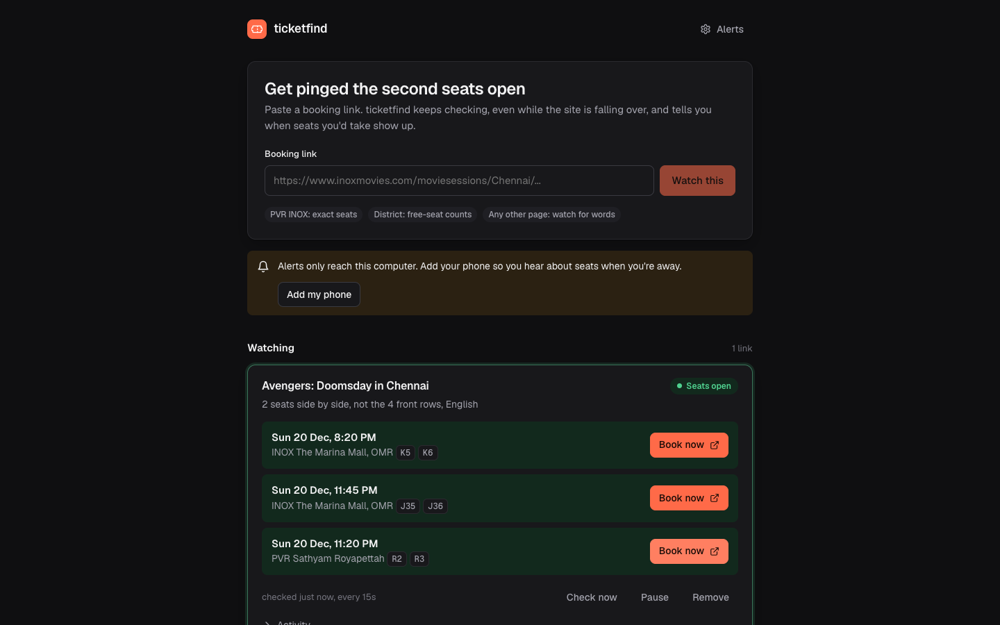
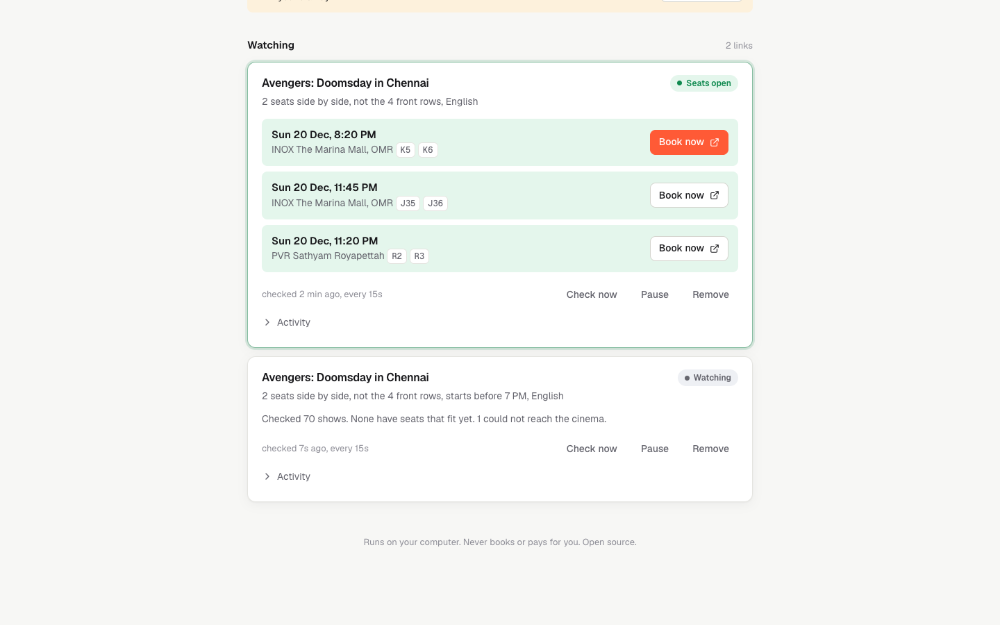

# ticketfind

**Get pinged the second seats open, even when the booking site is falling over.**

First-day shows, concerts, festival buses, a sold-out gig that drops 20 seats at midnight: the site crashes, seats flicker in and out, and whoever refreshes at the right second wins. ticketfind does the refreshing for you. Paste the booking link, say what you'd take ("2 seats side by side, not the front rows, before 7 pm"), and your phone buzzes the moment it shows up, with a **Book now** link straight to those seats.



- **Runs on your computer.** No account, no server, no Supabase. Your settings live in `~/.ticketfind`.
- **Never books or pays for you.** It finds the seats and hands you the link. You book like a normal person.
- **Cinemas near you.** Share your location in the browser and ticketfind keeps only cinemas within the distance you pick, nearest first. Your location never leaves your computer.
- **Kind to struggling sites.** It checks no faster than every 15 seconds and backs off when a site keeps failing.

## Start

```bash
npx ticketfind
```

It opens `http://127.0.0.1:4848`. Paste a link, pick what you need, press **Start watching**. Keep the terminal open.

### Get alerts on your phone

1. Install the free [ntfy](https://ntfy.sh) app (iOS, Android). No account.
2. In ticketfind, open **Alerts**, press **Make one** to get a random topic, then **Save**.
3. In ntfy, subscribe to that topic. Press **Send a test ping** to check.

Discord, Slack and Telegram work too (paste a webhook, or a bot token and chat ID).

### Plain words (optional)

Add a [Claude API key](https://console.anthropic.com/) under **Alerts** and type what you want instead of filling fields: *"2 seats together, not the front 4 rows, English, before 7 pm on the 17th or 18th"*. On any other site, Claude reads the page and picks the words that mean "on sale". The key stays on your computer. Without one, you fill the same fields by hand.

## What it can watch

| Site | What ticketfind sees | Paste this link |
|---|---|---|
| **PVR INOX** (inoxmovies.com, pvrcinemas.com) | Exact seats. Picks the best block for you. | The page that lists every show time (has `/moviesessions/` in it) |
| **District** (district.in) | Free-seat count per show. Counts can lag a little. | The movie page that lists every cinema (ends in `-MV` and a number) |
| **Concerts and events** (District events, Eventbrite, Skiddle, Dice, venue sites...) | Watches the event page for words like "Sold out", "Coming soon" or "Book tickets". Add a Claude key and it picks the words for you. | The event page you'd keep refreshing |
| **Any other page** (buses, sports, plays...) | Same: watches the page for the words that mean "on sale". | The page you'd keep refreshing |
| **BookMyShow** | Can't watch. It blocks automated checks. For PVR INOX cinemas, use inoxmovies.com or District: same seats. | |
| **Ticketmaster, AXS and other sites behind a queue or bot wall** | If the page blocks automated checks, ticketfind says so instead of trying to get around it. | |
| **IRCTC** | Won't watch. IRCTC forbids automated access and Tatkal bots are illegal under the Railways Act. Use IRCTC's own alerts. | |

Want another site? Adding one is a single file. See [docs/adapters.md](docs/adapters.md).



## What ticketfind will not do

- **Hold or buy seats for you.** A public tool that grabs seats during a rush takes them from everyone else at exactly the worst moment. ticketfind gets you to the seat page fast. The last click is yours.
- **Get around bot walls, captchas or logins.** If a site says no, the answer is no.
- **Hammer a site.** Minimum gap between checks, jitter, and backoff on errors are built in.

## Develop

```bash
pnpm install
pnpm dev          # server on :4848, UI with hot reload on :5173
pnpm test         # seat-picking and show rules
pnpm build        # builds dist/ for `npx ticketfind`
pnpm tsx scripts/smoke.ts <links...>   # live check against real sites
```

Code map:

```
src/server/
  cli.ts          start command
  app.ts          local HTTP API (127.0.0.1 only)
  engine.ts       timers, change detection, alerts
  rules.ts        seat picking and show filters (pure, tested)
  adapters/       one file per site
  notify/         desktop, ntfy, Discord, Slack, Telegram
  ai.ts           optional Claude: plain words to rules, page reading
web/src/          the UI (React, no UI kit, tokens in styles.css)
```

## License

MIT. See [LICENSE](LICENSE).
